# Manual do Usuário — Track do Oodeus

**Plugin do Obsidian para organizar estudos para concursos.**
Versão do plugin: **1.0.7** · Atualizado em **28/11/2026**

> Este manual foi feito para quem nunca usou o Obsidian nem o plugin. Comece pelo capítulo 1 e siga na ordem. As imagens mostram o plugin aberto no computador e no celular.

---

## Sumário

1. [O que é o plugin](#1-o-que-é-o-plugin)
2. [Noções básicas do Obsidian](#2-noções-básicas-do-obsidian)
3. [Instalar e atualizar](#3-instalar-e-atualizar)
4. [Primeiros passos](#4-primeiros-passos)
5. [Concursos](#5-concursos)
6. [Cadastro de edital](#6-cadastro-de-edital)
7. [Matéria, tópicos e subtópicos](#7-matéria-tópicos-e-subtópicos)
8. [Materiais de estudo e Anotações](#8-materiais-de-estudo-e-anotações)
9. [Cronômetro Pomodoro](#9-cronômetro-pomodoro)
10. [Cronograma Inteligente](#10-cronograma-inteligente)
11. [Flashcards](#11-flashcards)
12. [Dashboard e faixas](#12-dashboard-e-faixas)
13. [Revisões](#13-revisões)
14. [Métricas / Histórico](#14-métricas--histórico)
15. [Simulados](#15-simulados)
16. [Editais Premium](#16-editais-premium)
17. [Ajuda](#17-ajuda)
18. [Celular e tablet](#18-celular-e-tablet)
19. [Dados, backup e solução de problemas](#19-dados-backup-e-solução-de-problemas)
20. [Glossário rápido](#20-glossário-rápido)

---

## 1. O que é o plugin

O **Track do Oodeus** é uma reconstrução do aplicativo *Track Concursos* dentro do Obsidian. Ele transforma o seu cofre de notas em um caderno de estudos interativo:

- você cadastra **concursos** e **matérias**;
- divide cada matéria em **tópicos** e **subtópicos**;
- registra **questões**, **horas de estudo** e **simulados**;
- acompanha **faixas** ( branca → preta ) conforme seu progresso;
- usa **revisão espaçada**, **flashcards** (SRS) e **cronograma inteligente**;
- guarda **anotações** ligadas a notas do próprio Obsidian;
- funciona no **computador, celular e tablet**.

Tudo fica salvo dentro do seu cofre, no arquivo:

```
<seu cofre>/.obsidian/plugins/track-do-odeus/data.json
```

Ou seja: seus dados são seus, ficam no seu computador/celular, e não dependem de servidor.

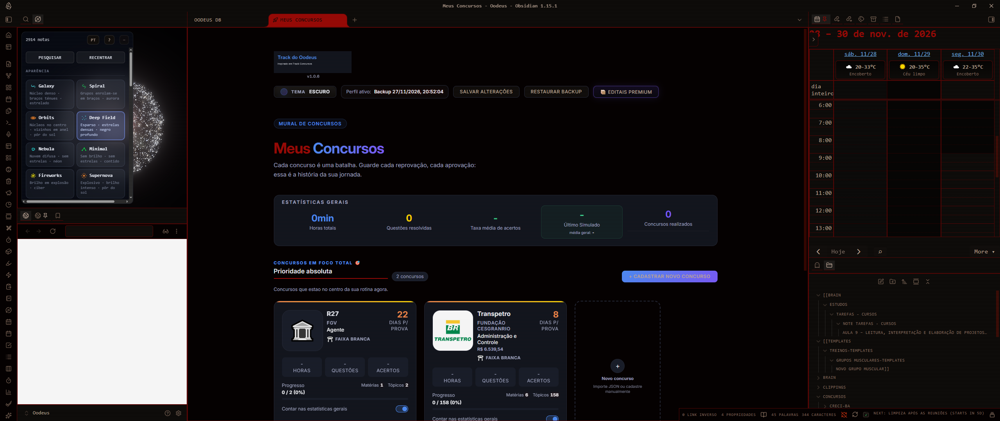
*Figura 1 — A tela "Meus Concursos", ponto de partida para criar e abrir concursos.*

---

## 2. Noções básicas do Obsidian

Se você nunca usou o Obsidian, leia esta parte com calma. Ela explica o que o plugin chama de "nota", "vault" e "wikilink".

### 2.1 O que é um cofre (vault)

O Obsidian trabalha com uma pasta chamada **cofre** (do inglês *vault*). Tudo que aparece no Obsidian são arquivos dessa pasta — principalmente arquivos `.md` (Markdown), que são notas de texto simples.

No seu caso, o cofre se chama **Oodeus DB**. Dentro dele existe uma pasta oculta `.obsidian`, onde ficam as configurações e os plugins — inclusive o Track do Oodeus.

> **Não apague a pasta `.obsidian`.** É onde o plugin e seus dados vivem.

### 2.2 O que é uma nota

Uma **nota** é um arquivo `.md`. Você cria uma nota pelo botão **＋** no topo do Obsidian, ou clicando em uma sugestão de link. Cada nota tem um **título** (o nome do arquivo) e um conteúdo que você escreve livremente:

```
# Minha nota de estudo

Aqui eu escrevo o que quiser: resumo, fórmulas, dicas...
```

No lado esquerdo do Obsidian existe o **Explorador de arquivos** (ícone de dois papéis). Lá você vê a árvore de pastas e notas do cofre.

### 2.3 O que é um wikilink `[[ ]]`

Este é o recurso mais importante para entender as Anotações do plugin.

Quando você digita **dois colchetes abertos** `[[` dentro de uma nota, o Obsidian abre uma lista com as notas existentes. Você continua digitando o nome, escolhe uma nota com a seta/Enter e o Obsidian insere automaticamente:

```
[[Nome da nota]]
```

Isso é um **link interno**: clicando nele, você abre aquela nota. Não precisa copiar caminho nem URL.

O plugin Track do Oodeus reproduz esse comportamento no campo **Link** do modal de material (capítulo 8).

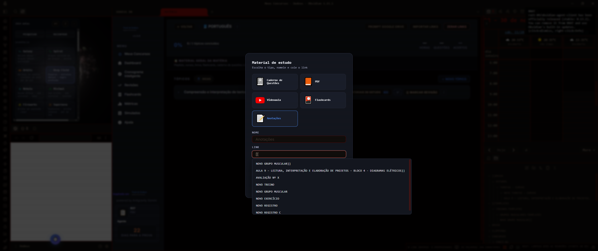
*Figura 2 — Digitando `[[` no campo Link, o plugin sugere notas do seu cofre, exatamente como o Obsidian.*

### 2.4 Como o plugin usa suas notas

O tipo de material **Anotações** não guarda um link da internet: ele guarda o **caminho de uma nota do seu cofre**. Quando você clica em "Abrir" nesse material, o plugin abre a nota dentro do próprio Obsidian — não cria outra nota, não abre o navegador.

---

## 3. Instalar e atualizar

### 3.1 Pelo BRAT (recomendado)

O **BRAT** é um plugin do Obsidian que instala e atualiza outros plugins direto do GitHub.

1. No Obsidian, abra **Configurações → Plugins da comunidade**.
2. Procure por **BRAT**, clique em **Instalar** e depois em **Ativar**.
3. Volte em **Configurações → BRAT** e clique em **Add beta plugin**.
4. No campo *Repository*, digite exatamente:

   ```
   oodeus369-byte/track-do-oodeus
   ```

5. Clique em **Select a version** e escolha a release mais recente (`v1.0.5` ou superior).
6. Clique em **ADD PLUGIN**.
7. Em **Plugins instalados**, habilite **Track do Oodeus**.

O repositório é **público**, então não precisa de token do GitHub.

Para atualizar no futuro: abra o BRAT e clique em **Update plugins**. Depois **recarregue o Obsidian** (Ctrl+R ou feche e abra o app) para o novo `main.js` entrar em memória.

### 3.2 Instalação manual

Se não quiser usar o BRAT:

1. No GitHub, clique em **Code → Download ZIP**.
2. Extraia o ZIP.
3. Copie `manifest.json` e `main.js` para:

   ```
   <seu cofre>/.obsidian/plugins/track-do-odeus/
   ```

4. Habilite o plugin em **Configurações → Plugins instalados**.
5. Recarregue o Obsidian.

> Desde a versão v1.0.3 os **92 assets** (imagens, ícones, faixas) vão embutidos dentro do `main.js`. Não é mais preciso copiar a pasta `assets/`.

### 3.3 Atenção ao usar dois aparelhos

Se você usa o mesmo cofre no PC e no celular com **Syncthing**:

- nunca apague arquivos `sync-conflict` sem comparar o conteúdo;
- se aparecer conflito, confira qual lado tem o `main.js` mais recente;
- para desinstalar/reinstalar pelo BRAT no mesmo aparelho, **desative a cópia antiga primeiro** (o ID do plugin é sempre `track-do-odeus`).

---

## 4. Primeiros passos

### 4.1 Abrindo o plugin

O plugin aparece como um ícone na barra lateral esquerda do Obsidian (um **foguete**). Clique nele para abrir uma aba com o painel do Track.

Você também pode usar o comando **Track do Oodeus: Abrir Track** na paleta de comandos (Ctrl+P).

Ao abrir, a primeira tela é **Meus Concursos**. Se você ainda não tem nenhum concurso, clique em **+ Cadastrar Novo Concurso**.

### 4.2 A barra lateral do plugin

Dentro do painel do Track há uma barra lateral própria, com:

- o nome **Track do Oodeus** (identificação "Inspirado em Track Concursos");
- **MENU**: Meus Concursos, Dashboard, Cronograma Inteligente, Revisões, Flashcards, Métricas, Simulados, Ajuda;
- o **concurso ativo** (nome, banca, cargo e dias para a prova).

Para navegar, basta clicar no item desejado. O plugin troca de página sem sair do Obsidian.

No celular, essa barra vira um **painel deslizante**: use o botão **☰** no canto superior para abrir/fechar. Toque fora do painel para fechar.

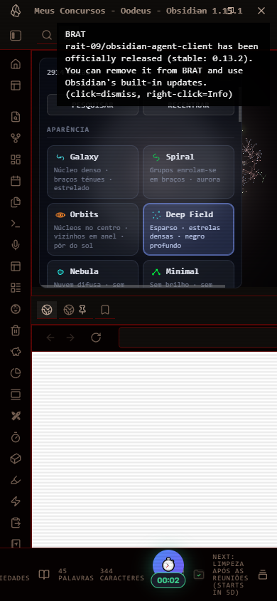
*Figura 3 — No celular, o botão ☰ abre e fecha a barra lateral.*

---

## 5. Concursos

A página **Meus Concursos** é o ponto de partida.

### Criar um concurso

1. Clique em **+ Cadastrar Novo Concurso**.
2. Preencha:
   - **Nome** (ex.: "Polícia Civil de Minas Gerais");
   - **Cargo** (ex.: "Agente");
   - **Banca** (ex.: "FGV");
   - **Data da prova**.
3. Salve. O concurso aparece no mural.

### Selecionar o concurso ativo

Clique no cartão do concurso. Ele passa a ser o **concurso ativo** — todas as páginas do plugin trabalham com ele. O nome e a contagem de dias aparecem na barra lateral.

### O que o plugin calcula

No mural você vê estatísticas gerais (horas totais, questões resolvidas, taxa de acertos, simulados) e a seção **Concursos em foco total**, com o gráfico de prioridade.

Depois de criar o concurso, o próximo passo é cadastrar as matérias — feito na página de cadastro de edital.

---

## 6. Cadastro de edital

Nesta página você importa ou monta a estrutura de matérias e tópicos do seu edital.

1. Abra **Meus Concursos → Cadastrar edital** (ou o atalho no cartão do concurso).
2. Você pode:
   - **colar o JSON** de um edital (obtido nos Editais Premium ou de outro concurso já instalado);
   - **escrever/editar** o conteúdo do edital no campo de texto;
   - usar **Prompt Google Drive**, **Importar links** ou **Zerar links** quando precisar.
3. Clique em **Salvar alterações**.

Dica: se você instalou um edital premium (capítulo 16), a estrutura já vem pronta — não é preciso digitar nada.

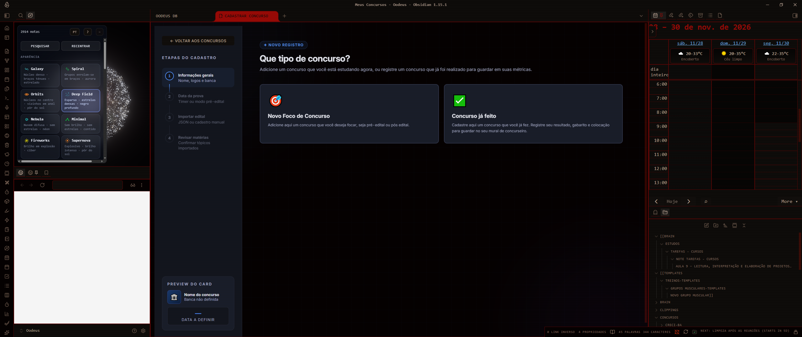
*Figura 4 — Tela de cadastro/edição do edital.*

---

## 7. Matéria, tópicos e subtópicos

A página **Matéria** é onde você estuda de verdade.

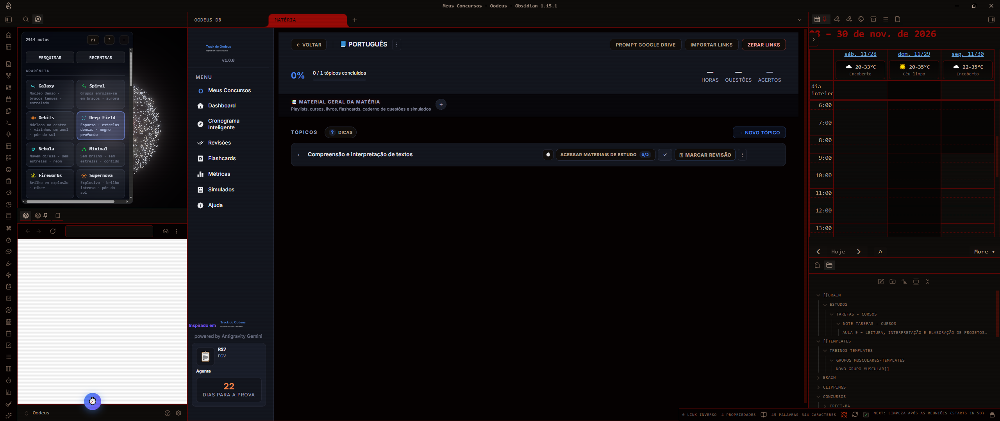
*Figura 5 — Matéria "Língua Portuguesa" com um tópico e seus botões.*

### 7.1 Estrutura

- **Matéria** (ex.: Língua Portuguesa)
  - **Tópico** (ex.: Compreensão e interpretação de textos)
    - **Subtópico** (ex.: Tipologias textuais)

Clique no nome de um tópico para **expandir** e ver os subtópicos e o conteúdo.

### 7.2 Botões de cada tópico/subtópico

Na linha de cada item aparecem cinco controles:

| Botão | O que faz |
|---|---|
| **⏱️** (cronômetro) | Inicia um cronômetro livre já ligado àquela matéria/tópico. |
| **＋** (mais) | Abre o modal **Material de estudo** para adicionar links, PDFs, vídeos, anotações etc. |
| **✓** (check) | Marca o item como **estudado** e abre o popup para agendar revisão (5/7/15/30 dias ou data). |
| **🗓 MARCAR REVISÃO** | Agenda uma revisão manual para aquele item, sem marcar como estudado. |
| **⋮** (opções) | Abre o menu com renomear, excluir e outras ações. |

### 7.3 Material geral da matéria

No topo da página existe o cartão **Material geral da matéria**, com o botão **＋**. Use-o para materiais que valem para a matéria inteira (playlists, livros, cadernos), em vez de um tópico específico.

### 7.4 Noções de progresso

No topo aparecem:

- **% de tópicos concluídos**;
- **Horas**, **Questões** e **Acertos** da matéria.

Eles são atualizados automaticamente quando você registra questões ou usa o cronômetro.

---

## 8. Materiais de estudo e Anotações

Ao clicar no **＋** de um tópico, abre-se o modal **Material de estudo**:

1. Escolha o **tipo**: Caderno de Questões, PDF, Videoaula, Flashcards ou **Anotações**.
2. Digite o **Nome**.
3. Preencha o **Link**:
   - para links externos, cole a URL completa (`https://...`);
   - para **Anotações**, use `[[` para escolher uma nota do seu cofre.
4. Clique em **Adicionar** ou **+ Adicionar em sequência** (para cadastrar vários seguidos).

Depois de adicionado, o material aparece na lista com os botões **EDITAR**, **ABRIR**, **MARCAR ESTUDADO** e **EXCLUIR**.

### 8.1 Usando `[[` no campo Link

1. Coloque o cursor no campo **Link**.
2. Digite `[[`.
3. Comece a escrever o nome da nota — aparece uma lista de sugestões.
4. Clique na nota desejada (ou use ↑/↓ + Enter).
5. O campo fica com `[[Nome da nota]]`.
6. Clique em **Adicionar**.

### 8.2 Abrindo a nota depois

No popup de materiais, clique em **ABRIR**. O plugin localiza a nota no cofre e a abre no Obsidian. Se a nota não existir mais, aparece um aviso — ele **não cria** uma nota nova.

> Se você não sabe o que é nota ou `[[ ]]`, volte ao capítulo 2.

### 8.3 Caminho universal: arquivo do vault

Para PDFs, vídeos e outros arquivos, **não use um caminho do computador** (`C:\...`) se você também usa o celular/tablet: esse caminho só existe naquele aparelho. Use o botão **📎 Buscar arquivo do vault**:

1. Coloque o arquivo (PDF, vídeo, imagem) em alguma pasta do seu cofre Obsidian.
2. No modal de material, clique em **📎 Buscar arquivo do vault**.
3. Escolha o arquivo na lista. O campo Link recebe o **caminho relativo**, por exemplo `Materiais/aula.pdf`.
4. Clique em **Adicionar**.

Esse caminho é o **mesmo no computador, no celular e no tablet**, porque o cofre é sincronizado. Não aparece mais o aviso "link bloqueado por segurança" e não é preciso ter `https://`.

Se você colar um caminho absoluto do Android (ex.: `/storage/emulated/0/Download/aula.pdf`), o plugin converte para `file:///storage/...` automaticamente — mas o arquivo pode não existir nos outros aparelhos. Por isso, **prefira sempre o botão do vault**.

**Regra importante para PDF e vídeo:** se o arquivo estiver **dentro do cofre**, o botão **Abrir** usa o **visualizador nativo de PDF do próprio Obsidian** — você **não precisa instalar nenhum plugin de PDF** (o Obsidian já vem com ele). O PDF abre em uma aba do Obsidian, junto das suas notas. Se o arquivo estiver **fora do cofre** (caminho `C:\...`, `/storage/...` ou uma URL externa), o plugin abre no **aplicativo externo** do dispositivo — e esse caminho pode não funcionar em outros aparelhos. Para abrir sempre dentro do Obsidian: **coloque o PDF em uma pasta do cofre e adicione pelo botão 📎 Buscar arquivo do vault.**

---

## 9. Cronômetro Pomodoro

O cronômetro é um **botão flutuante** (FAB) com ícone de relógio. Ele aparece quando você está em uma tela de estudo.

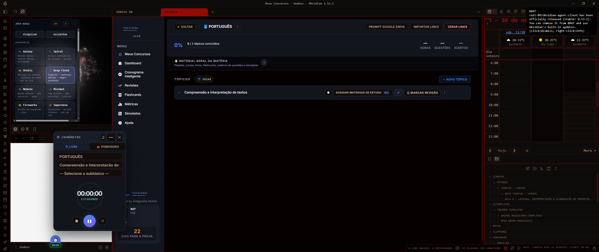
*Figura 6 — Painel do cronômetro com os modos Livre e Pomodoro.*

### 9.1 Abrir

- Clique no relógio flutuante.
- Ou clique no botão **⏱️** de um tópico para iniciar um cronômetro já ligado àquele item.

### 9.2 Modos

- **LIVRE**: cronômetro comum, você escolhe matéria, tópico e subtópico.
- **POMODORO**: ciclos de foco (25 min) e pausa (5/15 min).

Use os botões de play, pause/parar e reiniciar no painel.

### 9.3 Mover o relógio

- **No computador:** arraste o botão flutuante com o mouse para qualquer lugar da tela. A posição é lembrada.
- **No celular:** toque e arraste com o dedo. O botão para de aparecer quando você fecha a aba do plugin — não fica solto no Obsidian.

### 9.4 Registrar a sessão

Ao parar, o plugin abre um modal para salvar a sessão com matéria, tópico, questões feitas, acertos e observações. Depois de salvar, o tempo entra nas estatísticas e no cronograma.

---

## 10. Cronograma Inteligente

Nesta página você monta automaticamente um plano de estudos.

1. Abra **Cronograma Inteligente** no menu.
2. Se ainda não houver plano, clique em **COMEÇAR AGORA**.
3. Escolha a matéria/tópico, defina a **meta** e a **prioridade**.
4. O plugin gera uma grade semanal com os blocos de estudo.
5. Você pode **editar** blocos, marcar como feitos e acompanhar o progresso.

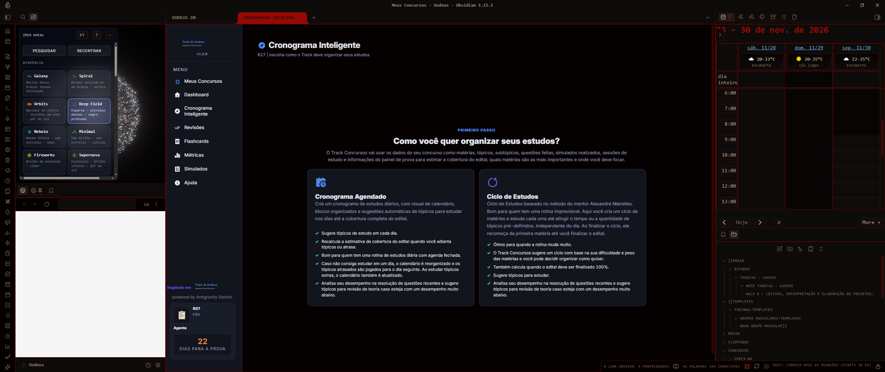
*Figura 7 — Grade semanal do Cronograma Inteligente.*

Dica: o cronograma usa os dados que você registra nas sessões de estudo (capítulo 9). Quanto mais você registra, melhores são as sugestões.

---

## 11. Flashcards

Os flashcards funcionam como um **caderno de perguntas e respostas com repetição espaçada (SRS)**: as cartas difíceis aparecem mais vezes; as fáceis, menos.

1. No menu, clique em **Flashcards**.
2. Clique em **+ Novo baralho** e dê um nome.
3. Abra o baralho e clique em ** Adicionar cartão** (ou equivalente).
4. Escreva a **frente** (pergunta) e o **verso** (resposta).
5. Para estudar, clique em **Estudar**. Vire a carta e avalie: novamente / difícil / bom / fácil.
6. Use **Exportar JSON** ou **Exportar CSV** para guardar seus baralhos.


*Figura 8 — Painel "Meus Baralhos" com estatísticas.*

Você também pode criar flashcards a partir de um material do tipo **Flashcards** dentro de um tópico.

---

## 12. Dashboard e faixas

O **Dashboard** é a visão geral do concurso ativo:

- cartões com horas estudadas, questões resolvidas, taxa de acertos, último simulado e tópicos concluídos;
- lista de matérias com progresso;
- cronograma semanal;
- painel da prova (configuração de questões, pesos e modo CEbraspe/Tradicional);
- **sistema de faixas**.

### 12.1 Sistema de faixas

As faixas vão de **Branca → Amarela → Vermelha → Laranja → Verde → Roxa → Marrom → Preta**. Cada faixa exige dias de estudo, questões e simulados com 80% de acerto. A regra é: **qualquer métrica isolada que bata já avança** de faixa — com bônus de cobertura e proteção contra regressão.

A Faixa Preta tem uma celebração especial.

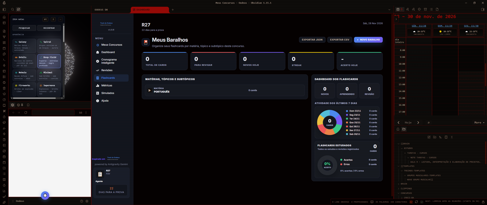
*Figura 9 — Dashboard com as estatísticas e o cronograma da semana.*

---

## 13. Revisões

A página **Revisões** organiza o que precisa ser revisitado.

- Veja os cards **Atrasadas**, **Para hoje**, **Próximas** e **Revisões concluídas**.
- Clique em um tópico para abrir o popup de revisão (5/7/15/30 dias ou data personalizada).
- O botão **MARCAR REVISÃO** em um tópico faz o mesmo sem marcar o item como estudado.
- Ao concluir uma revisão, marque como feita; o item sai da lista de pendentes.

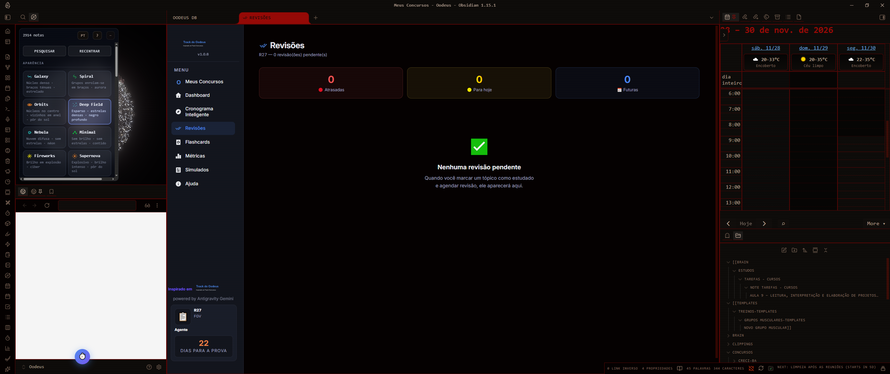
*Figura 10 — Painel de revisões pendentes.*

---

## 14. Métricas / Histórico

A página **Métricas** (History) mostra os gráficos e o histórico de estudo:

- heatmap estilo GitHub (níveis de intensidade por dia);
- análise por matéria (top 6);
- gráfico de pizza em horas com recorte;
- "Estudos do dia";
- cards de PRINT para compartilhar.

### 14.1 Exportar imagem (print/copiar)

1. Abra um dos cards PRINT.
2. Clique em **COPIAR IMAGEM**.
3. Se o navegador permitir, a imagem fica pronta para colar (Ctrl+V).
4. Se não permitir, o plugin **baixa o PNG** automaticamente.

O botão mostra "Gerando imagem…" e nunca trava a tela: se a cópia demorar, ele cai para download.

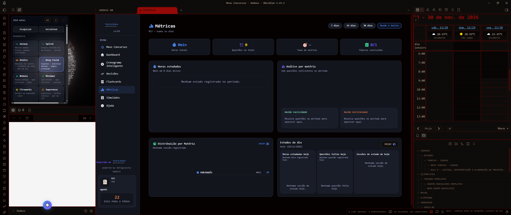
*Figura 11 — Página de Métricas com heatmap e gráficos.*

---

## 15. Simulados

Aqui você registra simulados realizados e acompanha a evolução.

1. Clique em **Registrar simulado**.
2. Preencha:
   - **Tipo** de simulado;
   - **Tempo gasto**;
   - **Nota** e total de questões;
   - **Modo de registro** (manual ou cálculo automático);
   - **Raio-x por matéria** (acertos/erros por matéria).
3. Salve.

O plugin calcula percentual, nota de corte e atualiza o gráfico de evolução. É possível **editar** e **deletar** simulados.

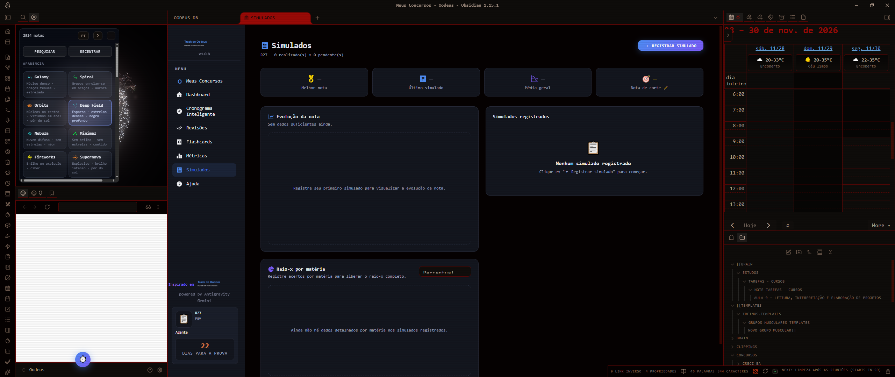
*Figura 12 — Página de Simulados.*

---

## 16. Editais Premium

Esta página mostra um catálogo de editais mantido pelo **desenvolvedor original**, fora do seu plugin.

### 16.1 De onde vêm os editais

O catálogo é baixado de:

```
https://raw.githubusercontent.com/michel-softwares/Editais-Premium/main/catalog.json
```

### 16.2 Como atualizar

1. Abra **Editais Premium** no menu.
2. Clique em **Atualizar** para buscar o catálogo mais recente.
3. Clique em **Instalar** no edital desejado.

O plugin baixa o arquivo do edital e o importa como um novo concurso no seu vault. Depois de instalado, o edital **não depende mais da internet** — os dados já estão no seu cofre.

> **Não é preciso atualizar o plugin para receber editais novos.** Quando o desenvolvedor publica algo novo no catálogo, basta abrir a página ou clicar em Atualizar. Se estiver sem internet, o plugin mostra a última cópia salva em cache.

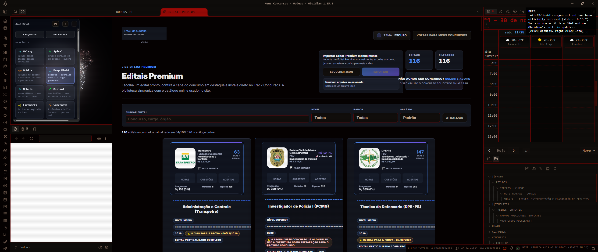
*Figura 13 — Catálogo de Editais Premium.*

---

## 17. Ajuda

A página **Ajuda** traz links úteis, informações sobre o projeto e formas de apoiar. Use-a quando tiver dúvidas rápidas ou quiser conferir a versão instalada.

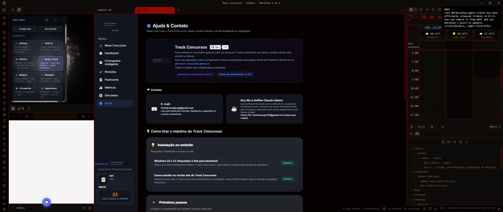
*Figura 14 — Página de Ajuda.*

---

## 18. Celular e tablet

O plugin é **mobile-friendly**: funciona em retrato, paisagem, tablet e computador.

- **Retrato:** a barra lateral fica escondida; use **☰** para abrir. O nome dos tópicos ocupa uma linha inteira e os botões vão para a linha seguinte.
- **Paisagem:** mais espaço; os cards se organizam em colunas.
- **Tablet:** layout intermediário.
- O relógio flutuante pode ser **arrastado com o dedo**; clicar nele abre o painel.
- O painel do cronômetro é centralizado e limitado à largura da tela — nunca fica cortado.

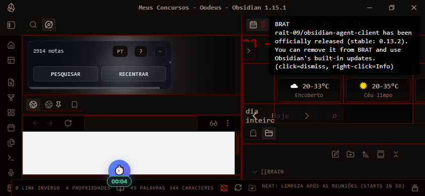
*Figura 15 — Vista em paisagem no celular.*

Dica: no celular, use o menu **☰** para alternar rapidamente entre Concursos, Dashboard, Matéria e as demais páginas.

---

## 19. Dados, backup e solução de problemas

### 19.1 Onde estão seus dados

- **Dados do plugin:** `.obsidian/plugins/track-do-odeus/data.json` (concursos, matérias, tópicos, sessões, simulados etc.).
- **Notas do Obsidian:** arquivos `.md` espalhados pelo cofre.
- **Configurações do plugin:** pasta `.obsidian/plugins/track-do-odeus/`.

### 19.2 Backup

O resgate automático fica em:

```
C:\Users\maest\Backups\track-resgate-2026-11-26\
```

Lá estão o `main.js`, o `data.json` e os projetos de código. O `deploy.js` foi corrigido para **nunca apagar o `data.json`** — ele faz cópia com timestamp antes de atualizar o plugin.

### 19.3 Problemas comuns

| Sintoma | O que fazer |
|---|---|
| Imagem de faixa/logo quebrada | Atualize para v1.0.3+; os assets estão embutidos. |
| Não aparece o botão ☰ no celular | Recarregue o Obsidian após atualizar. |
| Barra lateral não abre | Toque em ☰; para fechar, toque fora do painel. |
| Botões da matéria não respondem | Verifique se há um modal invisível: recarregue a página do plugin. |
| FAB não arrasta no celular | Atualize para v1.0.2+; use toque e arraste. |
| "Link bloqueado por segurança" | Use `[[Nota]]` para notas do vault e `https://...` para links externos. |
| PDF abre em aplicativo externo | O PDF está fora do cofre. Coloque-o em uma pasta do Obsidian e adicione com **📎 Buscar arquivo do vault**. O leitor de PDF do Obsidian é nativo. |
| Editais premium não carregam | Verifique a internet e clique em Atualizar; sem rede, aparece o cache. |
| Configurações do Obsidian parecem não abrir | Elas abrem em uma janela separada; use **Alt+Tab** para trazer "Configurações - Oodeus" para frente. |
| Conflito no Syncthing | Não apague na dúvida: compare os arquivos e mantenha o `main.js` mais recente. |

### 19.4 Recarregando o plugin

Depois de qualquer atualização: **Ctrl+R** no Obsidian (ou feche e reabra o app). Isso garante que o novo `main.js` seja carregado.

---

## 20. Glossário rápido

| Termo | Significado simples |
|---|---|
| **Vault / cofre** | A pasta onde o Obsidian guarda suas notas. |
| **Nota** | Um arquivo `.md` que você escreve no Obsidian. |
| **Wikilink `[[ ]]`** | Link interno para outra nota; digitando `[[` o Obsidian sugere notas. |
| **Plugin** | Um complemento que adiciona funções ao Obsidian. |
| **Concurso ativo** | O concurso que o plugin está usando no momento. |
| **Matéria** | Matéria de estudo dentro do concurso. |
| **Tópico / subtópico** | Divisões da matéria. |
| **Faixa** | Nível de progresso (Branca a Preta). |
| **SRS** | Repetição espaçada: sistema dos flashcards. |
| **Pomodoro** | Técnica de foco com blocos de 25 min e pausas. |
| **RAW / storage** | Dados brutos salvos pelo plugin em `data.json`. |
| **BRAT** | Plugin que instala/atualiza plugins do GitHub. |

---

**Fim do manual.**

*Track do Oodeus — versão 1.0.7 · "Inspirado em Track Concursos". Repositório: `oodeus369-byte/track-do-oodeus`.*
